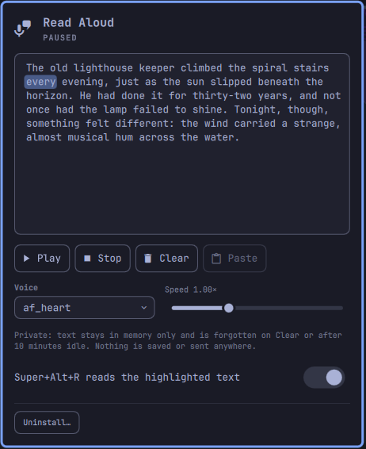

# Read Aloud for Omarchy

Private, offline text-to-speech in the [Omarchy](https://omarchy.org) bar.
Highlight text anywhere and press `Super+Alt+R`, or paste it into the panel and
press Play. The voice is [Kokoro-82M](https://huggingface.co/hexgrad/Kokoro-82M),
running on your CPU: nothing is sent anywhere, and nothing is saved.



## Install

```bash
omarchy plugin add https://github.com/jebin2/omarchy-read-aloud.git --enable
omarchy restart shell
```

A speaker icon (󰔊) appears in the bar. Click it and press **Set up**. Setup
installs the voice engine in your home folder and downloads the voice model
(165 MB, once). If [Bun](https://bun.sh) isn't installed, it asks for your
password to install the Arch `bun` package. That's the only step that needs it.

Then turn on **Super+Alt+R reads the highlighted text** in the panel if you
want the shortcut. It adds a marked block to `~/.config/hypr/bindings.lua`,
and turning the switch off removes it.

Setup can also run from a terminal:
`~/.config/omarchy/plugins/jebin2.read-aloud/bin/read-aloud-setup setup`.

## Use

- **Highlight text and press `Super+Alt+R`.** Press it again on the same text
  to stop; highlight something else and press it to switch.
- **Or open the panel**, paste or type text, and press **Play**.
- The panel shows the text with **the word being spoken** highlighted, and has
  Play/Pause, Stop, Clear, Paste, voice and speed. `af_heart` and `af_bella`
  are the best-rated voices.

### Which highlight is read

The text highlighted in the window under the pointer. If
[pique](https://github.com/jebin2/pique) is installed, Read Aloud uses its
helpers (`engine/selection.py` imports them from `pique-peek`):

- **GTK and Qt apps** are asked over the accessibility bus for their
  selection right now.
- **Everything else** (terminals, browsers): `pique-watch`'s memory of that
  window's last highlight, which a plain click in the window forgets. So a
  highlight you clicked away, or one in another window, is never read by
  mistake.
- `pique-watch` keeps at most 2,000 characters per window. When the window's
  highlight is also the latest one on the system (the usual case), the full
  text comes from the primary selection; only an older highlight in a
  window you are pointing back at is cut at 2,000 characters.

**Without pique** (the default), it reads the primary selection: the last
text highlighted anywhere.

## Uninstall

Panel → **Uninstall…** → **Remove**. It stops and removes the service, the
engine and model (`~/.local/share/omarchy-read-aloud`), the `read-aloud`
command, the shortcut, and the plugin. Bun stays installed
(`omarchy pkg drop bun` removes it). From a terminal:
`~/.config/omarchy/plugins/jebin2.read-aloud/bin/read-aloud-setup uninstall`.

## Privacy: incognito only

| | |
| --- | --- |
| Text | Held in RAM only, in the daemon. Forgotten on **Clear**, or after 10 minutes without playback; a draft in the panel that was never played is forgotten after 10 minutes too. Never written to disk, logged, or put in command arguments (which any local user can read in `/proc`). |
| Audio | Generated in RAM, played straight to PipeWire, and dropped once heard. Never saved. |
| Socket | `$XDG_RUNTIME_DIR/omarchy-read-aloud/control.sock` (tmpfs), directory `0700`, socket `0600`. |
| Logs | State changes only (`phase=playing`, `engine.start`); no text and nothing derived from it. |
| Crashes | No core dumps (which would contain the text): `LimitCORE=0` for the service, `ulimit -c 0` for the `read-aloud` command. |
| Network | None at runtime (`READ_ALOUD_OFFLINE=1`). Setup downloads the model once. |

The service is also sandboxed by systemd, so these hold even if the code (or a
library) tried otherwise:

- **No network:** only Unix sockets can be opened (`RestrictAddressFamilies=AF_UNIX`).
- **No disk writes:** home and system are read-only; `/tmp` and `/var/tmp`
  are private RAM disks gone when it stops; the only writable path is the
  socket's directory, also RAM.
- **No swap:** its memory is never swapped out (`MemorySwapMax=0`).

Verified by reading a random marker text through every command (speak,
replace mid-read, voice change, pause, resume, stop, clear) and searching the
system and user journals and every file written meanwhile: no trace.

Hibernation writes all of RAM to disk; keep the disk encrypted if you use it.
In shell examples, piped text can land in your shell history: prefer
`wl-paste | read-aloud speak` or a file to typing the text in the command.

## How it works

```
Super+Alt+R ─► read-aloud selection ─┐            ┌─► pw-play ─► speakers
                                     ├─► speakd ──┤
bar panel (Quickshell Socket) ───────┘  (~40 MB)  └─► synth.ts (Kokoro, ONNX)
                                                       started on demand,
                                                       killed when done
```

- **`speakd.ts`**, the daemon (a systemd user service, about 40 MB). It holds
  the text and runs the read: what to synthesize, play and highlight. Its
  parts, each usable on its own:
  - `segment.ts`: text → words and chunks (sentences, with the short opening ramp);
  - `align.ts`: model output → trimmed PCM and word start times;
  - `engine-client.ts`: starts, talks to and kills the model process;
  - `player.ts`: `pw-play`;
  - `server.ts`: the private control socket.
- **`synth.ts`**, the model process. Started on the first request, it
  synthesizes the whole text back to back (up to 10 minutes ahead) and is then
  **killed at once**, so its memory is returned while the buffered audio is
  still playing.
- **`Panel.qml`**, the bar widget. It keeps one live connection to the
  socket; the daemon pushes the text and playback state to it.

### Measured (i7-13700HX, 73 s of audio)

| | |
| --- | --- |
| Time to first audio (cold, key press → sound) | ~0.8 s short sentence, ~0.87 s long sentence or paragraph |
| Synthesis speed | ~0.22× real time (16 s for 73 s) |
| Model process | 308 MB loaded, ~590 MB peak, alive ~18 s for 73 s of audio |
| Daemon | ~40 MB, the only thing running when idle |
| Disk | 318 MB engine + 165 MB model |

The figures above were measured with the uint8 model. Since 0.1.1 the model is
fp16, which sounds closer to the full-precision voice. Side by side through
`synth.ts` (77 s of audio), fp16 took 17.7 s against 15.0 s for uint8 (4.3x
against 5.1x real time) with the same peak memory (851 vs 865 MB), so expect
synthesis about 18% slower and the first chunk about 0.1–0.3 s later. fp32
measured the same speed as fp16 but ~290 MB more memory; q8 was 3x slower.

Where the first-word time goes (cold): CLI 25 ms, Bun + imports 70 ms, model
session ~330 ms, tokenizer/phonemizer ~50 ms, then synthesis of the first chunk,
which grows with its length (~0.4 s for 4 words, ~1.7 s for 17). So:
- The opening is cut into a ramp of growing pieces, 3 → 5 → 12 words
  (`READ_ALOUD_RAMP`), preferring a comma or the spot before a joining word:
  "Dragon Ball is | a massive global media franchise | created by legendary…".
  Each piece costs ~0.3 s fixed plus ~0.2 s per second of speech, and plays
  long enough to cover synthesizing the next one. Paragraph: 2.3 s → 0.87 s.
  Audible silence measured with a real-time sink: 0.00 s at 6 threads, at most
  0.14 s with the CPU limited to 2 threads.
- ORT graph optimization is `basic`: loads ~80 ms faster than `all`, same speed.
- The first audio is written to the player at once, not on the next 40 ms tick.

### Word highlighting

Exact, not estimated. Kokoro predicts a duration for every phoneme token
before it generates audio; the stock ONNX model just does not output it.
`patch-model.ts` exposes that tensor (`/encoder/Gather_output_0`) as a second
output by appending one 48-byte record to the model file (no Python, every
other byte unchanged; passes the ONNX checker). One frame is exactly 600
samples, and space tokens split the timeline into spoken words.

Spoken words are mapped to written words one to one; when a number or symbol
expands ("260" → "two hundred sixty", "1984" → "nineteen eighty four"), the
extra spoken words go to it. The panel highlights 80 ms behind the playhead to
match the player's buffering.

Memory choices, with measurements:
- ONNX Runtime weight pre-packing is off: −100 MB for ~3% speed.
- Synthesis runs back to back: idle gaps between generations cost +120 MB.
- The model unloads immediately when done (`READ_ALOUD_IDLE_UNLOAD_SEC=0`):
  about a second after it goes idle, the Bun runtime grows by ~150 MB, and no
  GC setting avoided it. The cost is a cold start on every read.

## What setup installs

| What | Where |
| --- | --- |
| Engine (Bun + `kokoro-js`) | `~/.local/share/omarchy-read-aloud/engine` |
| Voice model (fp16, patched for word timing) | `~/.local/share/omarchy-read-aloud/models` |
| `read-aloud` command | `~/.local/bin/read-aloud` |
| Service | `~/.config/systemd/user/omarchy-read-aloud.service` (enabled) |
| Shortcut (only if you turn it on) | marked block in `~/.config/hypr/bindings.lua`, previous version in `bindings.lua.bak.read-aloud` |
| Bun (only if missing) | Arch package `bun`, with your password |

Setup is the only time anything goes online: the engine's npm packages and
the model from Hugging Face. When a plugin update changes the engine, the
panel shows an **Update** card.

Needs PipeWire (`pw-play`), `wl-clipboard` and Python 3, all part of Omarchy.

## Command line

```bash
read-aloud selection                 # what Super+Alt+R runs
wl-paste | read-aloud speak       # text only on stdin, never as arguments
read-aloud toggle | pause | resume | stop | clear | status
read-aloud set voice bf_emma
read-aloud set speed 1.2             # applies from the next sentence
```

Settings (environment of the service): `READ_ALOUD_VOICE`, `READ_ALOUD_SPEED`,
`READ_ALOUD_THREADS` (default 6), `READ_ALOUD_IDLE_UNLOAD_SEC` (default 0),
`READ_ALOUD_FORGET_SEC` (default 600), `READ_ALOUD_MAX_CHARS` (default 200000),
`READ_ALOUD_RAMP` (default `3,5,12`).

Changing the voice or speed during a read re-synthesizes everything not yet
sent to the player, so it is heard from the next sentence.

## Tests

```
cd engine && bun install && bun test
```

Unit tests for splitting, word alignment, the model patch and the model
process lifecycle (stop while loading, crash); no model or audio needed.

## License

GPL-3.0-only. The engine depends on `kokoro-js` → `phonemizer`, which embeds
eSpeak NG (GPL-3.0-or-later). Kokoro-82M is Apache-2.0.
